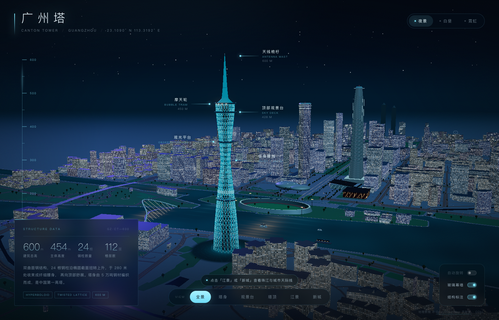

# 广州塔 · Canton Tower 3D

一个无需构建步骤的广州塔 / 珠江新城三维交互场景。使用原生 ES Modules、Three.js 与 OpenStreetMap 数据，在浏览器中还原塔身、双塔、花城广场、珠江两岸以及城市中的车流、行人与船只。



## 功能

- **广州塔**：参数化双曲面钢结构、24 根扭转钢柱、摩天轮、观景台与灯光。
- **城市环境**：基于 OSM 的建筑体量、道路、公园、水域、桥梁、树木，以及人行道、路缘石、斑马线、路灯、滨江栏杆、长椅和垃圾桶等街道细节。
- **城市动态**：约 335 辆汽车沿车道行驶（弯道减速、路口红灯停车）、460 名行人、74 组信号灯和 9 艘珠江船只。
- **点击跟随**：点击任意汽车、行人或船只，镜头会飞到目标附近并持续跟随；点击空白处、按 `Esc` 或点 HUD 上的「退出」结束。
- **天气系统**：晴朗 / 细雨 / 暴雨 / 浓雾四种天气，可随时开关；雨丝、闪电、雾密度与天空颜色会平滑过渡，并可与夜景 / 白昼 / 霓虹外观自由组合。
- **外观与视角**：夜景、白昼、霓虹三套配色；全景、塔身、观景台、塔顶、江景、新城六个机位。
- **HUD**：高度标尺、结构标注、地标标注、自动旋转、玻璃幕墙和城市动态开关。

## 运行

项目是纯静态站点，不需要 npm / 打包工具。推荐使用自带的无缓存静态服务器：

```bash
python3 scripts/dev_server.py 8123 .
```

然后打开 <http://localhost:8123>。

也可以使用任意静态服务器，例如：

```bash
python3 -m http.server 8123
```

> 必须通过 HTTP 访问，不能直接双击 `index.html`（ES Modules 与 import map 需要同源 HTTP 环境）。

## 目录结构

```text
.
├── index.html                  # 页面骨架、HUD、import map
├── css/
│   └── style.css               # HUD、天气面板、跟随状态、响应式样式
├── src/
│   ├── main.js                 # 渲染器、相机、后期、模式 / 天气 / 跟随整合、主循环
│   ├── config/
│   │   ├── modes.js            # 夜景 / 白昼 / 霓虹参数
│   │   └── views.js            # 六个镜头预设
│   ├── core/
│   │   ├── geometry.js         # 几何合并工具
│   │   └── utils.js            # 随机数、折线、颜色、曲线等通用工具
│   ├── data/
│   │   └── city-data.js        # 由 OSM 原始数据生成的紧凑场景数据
│   ├── scene/
│   │   ├── environment.js      # 场景总装配
│   │   ├── tower.js            # 广州塔塔身
│   │   ├── sky.js              # 天空与星空
│   │   ├── terrain.js          # 地面、广场、公园、水面、滨江步道
│   │   ├── roads.js            # 道路几何与路面纹理
│   │   ├── building-mass.js    # 建筑体量与窗格着色器
│   │   ├── landmarks.js        # 双塔、剧院、博物馆、图书馆、体育场等
│   │   ├── bridges.js          # 桥梁
│   │   ├── vegetation.js       # 树木
│   │   ├── effects.js          # 城市灯火与桥上车流
│   │   ├── boats.js            # 珠江船只
│   │   ├── details.js          # 人行道、斑马线、路灯、长椅、栏杆等
│   │   └── materials.js        # 全城共享材质
│   ├── city/
│   │   ├── life.js             # 车流 / 行人 / 信号灯装配
│   │   ├── road-network.js     # 道路采样、平滑、车道与路口
│   │   ├── traffic.js          # 车辆运动与车灯
│   │   ├── pedestrians.js      # 行人路径与动画
│   │   └── signals.js          # 信号灯相位与实体
│   └── systems/
│       ├── focus.js            # 点击拾取、镜头跟随、目标指示环
│       └── weather.js          # 天气预设、雨丝、闪电与 snapshot 叠加
├── assets/
│   ├── data/raw/               # OSM / Overpass 原始 JSON
│   ├── preview/                # README / 展示用预览图
│   └── screenshots/            # 历史截图与地图
├── scripts/
│   ├── build_city_data.py      # 原始 OSM 数据 → src/data/city-data.js
│   ├── dev_server.py           # 无缓存开发服务器
│   ├── capture_server.py       # 可选的画布截图接收器（开发辅助）
│   ├── map_svg.py              # 数据地图导出
│   └── map_axis.py             # 中轴线示意导出
└── vendor/three/               # 本地 Three.js 与 addons
```

## 操作

| 操作 | 说明 |
| --- | --- |
| 左键拖拽 | 环绕旋转 |
| 滚轮 / 双指 | 缩放 |
| 右键拖拽 | 平移 |
| 单击汽车 / 行人 / 船只 | 进入跟随视角 |
| 单击空白 / `Esc` | 退出跟随 |
| 右上角 WEATHER | 切换天气 |
| 右上角夜景 / 白昼 / 霓虹 | 切换外观模式 |
| 底部 VIEW | 切换镜头预设 |
| 右下角开关 | 自动旋转、玻璃幕墙、结构标注、城市动态 |

## 重建城市数据

`src/data/city-data.js` 已包含构建结果。若修改了 `assets/data/raw/` 中的原始 OSM 数据，可重新生成：

```bash
python3 scripts/build_city_data.py
```

脚本会读取 `assets/data/raw/*.json`，输出 `src/data/city-data.js`。局部坐标以广州塔中心为原点，单位为米，`x` 向东、`z` 向南、`y` 向上。

## 实现说明

- **车辆沿道路行驶**：车辆使用 Chaikin 平滑后的道路中心线采样，横向偏移与路面纹理中的车道线对齐；根据前方转角限速，并在路口按信号灯相位停车。道路两端用缩放淡出隐藏循环瞬移。
- **点击跟随**：通过射线检测 `InstancedMesh` 的 `instanceId` 定位具体车辆 / 行人，船则沿父级找到对应记录；跟随时镜头随目标位移同步平移，仍保留 OrbitControls 的环绕操作。
- **天气**：雨丝与闪电是独立场景对象；雾、天空、灯光和曝光通过 `snapshot` 叠加到当前外观模式上，因此天气与三种外观可以任意组合，切换时共用一个缓动过渡。
- **性能**：建筑、道路按类别合并，车辆 / 行人 / 街道家具使用 `InstancedMesh`，窗格和地面细节在着色器中按屏幕导数抗锯齿。

## 数据与许可

地理数据 © [OpenStreetMap 贡献者](https://www.openstreetmap.org/copyright)，遵循 ODbL 许可。Three.js 遵循 MIT 许可。
